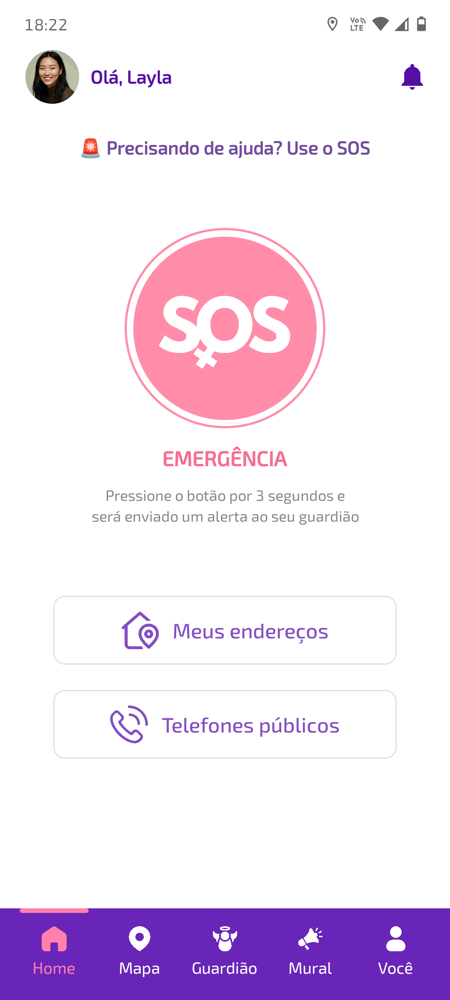
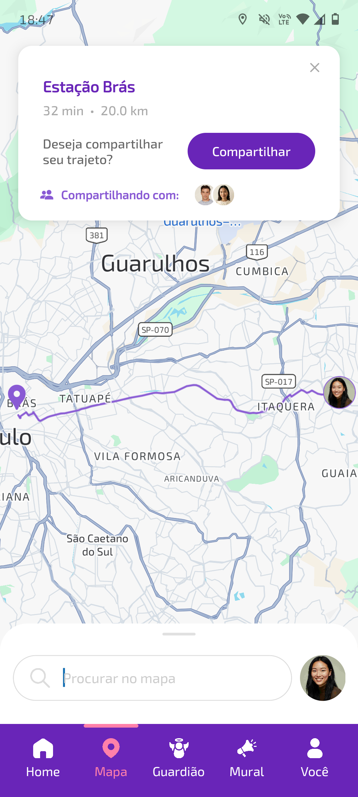
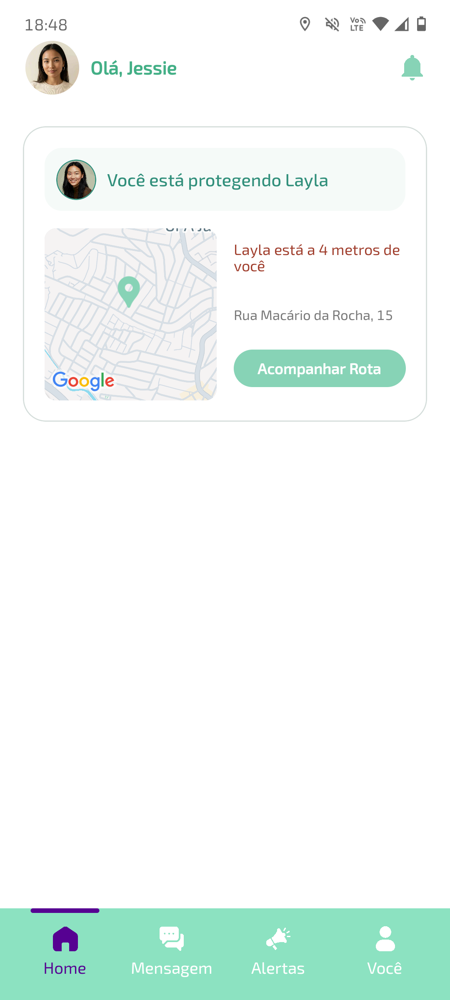
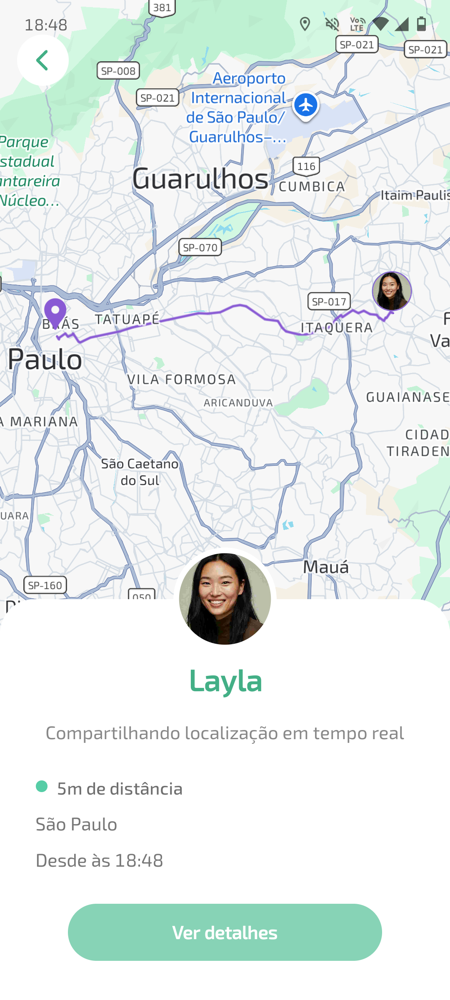
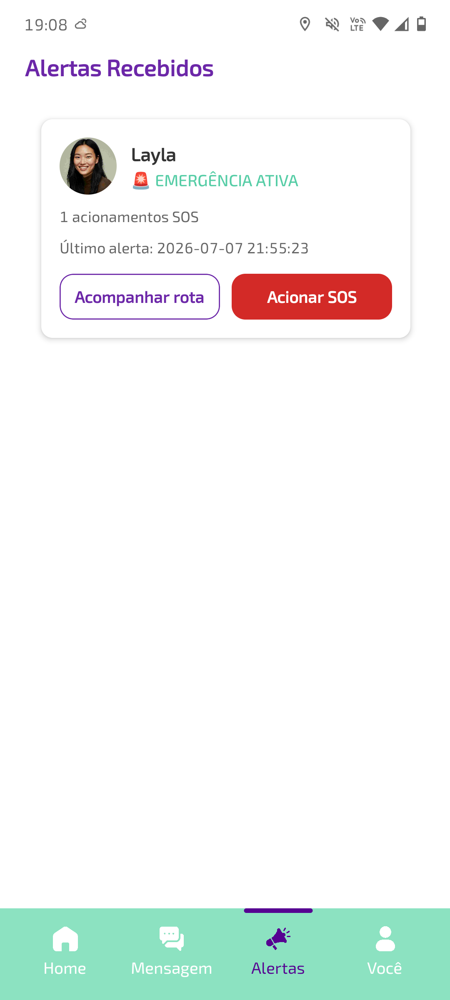

<div align="center">
  
</div>
<br>

<div align="center">


</div>

Aplicativo mobile desenvolvido como Trabalho de Conclusão de Curso em Desenvolvimento de Sistemas da ETEC de Guaianazes. A proposta é oferecer recursos de apoio à segurança de mulheres durante seus deslocamentos, com localização, compartilhamento de rotas e contato com pessoas de confiança.

O projeto tem dois perfis:

- 💜 **Usuária:** acessa os recursos de mapa, localização, SOS, comunicação e gerenciamento de guardiões.
- 💚 **Guardião:** recebe solicitações de compartilhamento de rota, acompanha a localização compartilhada e recebe alertas.

## 🔗 Funcionalidades

- Cadastro e login para usuárias e guardiões.
- Mapa com localização atual, busca de endereço e traçado de rota.
- Compartilhamento de trajeto com guardiões.
- Botão SOS que envia a localização à API.
- Chat entre usuária e guardião.
- Cadastro e gerenciamento de guardiões e endereços de confiança.
- Mural de notícias relacionadas a segurança, direitos e bem-estar.

Os recursos de autenticação, SOS, mensagens e compartilhamento de rotas dependem do backend. Favoritos e curtidas do Mural são salvos localmente no aparelho. Durante o uso do mapa, a localização é atualizada periodicamente.

## 👩🏻‍💻 Tecnologias e arquitetura

- **Aplicativo:** React Native, Expo e JavaScript.
- **Navegação e interface:** React Navigation e React Native Paper.
- **Localização e mapas:** Expo Location e React Native Maps.
- **Comunicação com a API:** Axios.
- **Backend:** Laravel 10 e PHP 8.1 ou superior, em um repositório separado.
- **Banco de dados:** MySQL.
- **Rotas:** serviço Project OSRM.
- **Notícias:** Google News RSS consultado por meio do serviço RSS2JSON.

O aplicativo chama endpoints da API para autenticação, cadastro, localização, SOS, rotas compartilhadas, guardiões e mensagens. O backend está no [repositório app-viva-segura-backend](https://github.com/Kaawanny/app-viva-segura-backend).

## 📲 Capturas de tela

### Perfil de usuária 

| Início | Mural de notícias | Mapa |
|---|---|---|
|  |  |  |

### Perfil de guardião 

| Início | Acompanhar rota | Central de alertas |
|---|---|---|
|  |  |  |

## 📁 Estrutura do projeto

```text
viva-segura/
├── assets/                         # Imagens e ícones do aplicativo
├── docs/
│   └── screenshots/                # Capturas usadas na documentação
├── src/
│   ├── components/                 # Componentes reutilizáveis
│   ├── Screens/                    # Telas do aplicativo
│   │   └── Mural/
│   │       └── services/
│   │           └── apiMural.js     # API do mural de noticias
│   └── services/
│       └── api.js                  # Cliente HTTP da API
├── App.js                          # Configuração da navegação
├── index.js                        # Registro do app no Expo
├── app.json                        # Configuração do Expo
├── package.json                    # Scripts e dependências
├── package-lock.json
└── README.md
```

## 💻 Como executar localmente

Para usar autenticação, SOS, chat, compartilhamento de rotas e dados salvos, o backend precisa estar em execução. No teste com Expo Go no celular, o celular e o computador que executa a API precisam estar na mesma rede Wi-Fi.

### 1. Configurar o backend

Pré-requisitos:

- PHP 8.1 ou superior
- Composer
- MySQL (o XAMPP pode ser usado para iniciar o MySQL localmente)

Clone o repositório do backend e instale as dependências:

```bash
git clone https://github.com/Kaawanny/app-viva-segura-backend.git
cd app-viva-segura-backend
composer install
```

Crie o arquivo `.env` a partir do exemplo:

```bash
copy .env.example .env
```

No macOS ou Linux:

```bash
cp .env.example .env
```

Inicie o MySQL e configure no `.env` a conexão com o banco. O arquivo `.env.example` do backend usa estes valores locais como padrão; ajuste-os se sua instalação do MySQL for diferente:

```dotenv
DB_CONNECTION=mysql
DB_HOST=127.0.0.1
DB_PORT=3306
DB_DATABASE=laravel
DB_USERNAME=root
DB_PASSWORD=
```

Crie no MySQL o banco informado em `DB_DATABASE`. Em seguida, gere a chave da aplicação, crie as tabelas e carregue os dados iniciais:

```bash
php artisan key:generate
php artisan migrate
php artisan db:seed --class=RoleSeeder
php artisan db:seed --class=LocalSeguroSeeder
```

Inicie a API permitindo conexões pela rede local:

```bash
php artisan serve --host=0.0.0.0 --port=8000
```

### 2. Configurar o aplicativo

Clone este repositório, instale as dependências e inicie o Expo:

```bash
git clone https://github.com/monigata/viva-segura.git
cd viva-segura
npm install
npx expo start
```

O Expo exibirá um QR Code. Abra o Expo Go no celular e escaneie o código, ou execute o projeto em um emulador.

### 3. Configurar o endereço da API

Antes de abrir o aplicativo no celular, edite `src/services/api.js`. Substitua o endereço base pelo IP local do computador onde o backend está rodando:

```js
baseURL: "http://SEU_IP_LOCAL:8000/api"
```

No Windows, use `ipconfig` e procure o endereço IPv4 da rede Wi-Fi. Por exemplo, se o endereço do computador for `192.168.1.25`, configure:

```js
baseURL: "http://192.168.1.25:8000/api"
```

Não use `localhost` no celular: nesse caso, ele apontaria para o próprio aparelho. O IP deve corresponder ao computador que está executando o backend.

## 👀 Observações

- O endereço da API está configurado diretamente em `src/services/api.js`; cada ambiente local pode exigir um IP diferente.
- O mural depende de serviços externos para carregar notícias.
- Os passos do backend descrevem a configuração local usada pelo projeto. O repositório do backend contém um README padrão do Laravel, sem documentação específica do Viva Segura.
